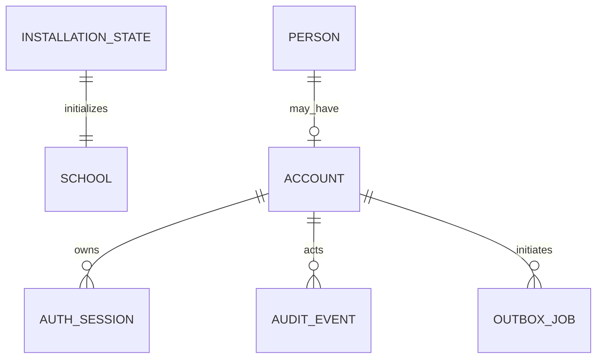

> Historical reference from before the October 10, 2026 reset. This does not describe the current application. See the root README.

# Architecture, contracts and delivery backlog

> Onboarding update (October 10, 2026): earlier mandatory-MFA and operator-only installer decisions below are superseded by email/password login and the documented, configurable setup password. See [current onboarding and boundaries](../OPERATIONS.md#local-installation). Legacy MFA columns/key remain for database and backup compatibility; they do not gate access.
The modular Python core owns all business state. Frontend: `apps/web`; owned components: `packages/ui`; generated OpenAPI: `packages/api-client`. API/worker/AI entry points remain separate. The AI service is a skeleton; it performs no educational orchestration in P1.

## P1 entity model

InstallationState is a singleton with a deployment UUID, expiring bootstrap digest, revisioned draft and durable completion receipt. School settings hold the initial year and privacy defaults. P2 now normalizes academic years and structures; the migration copies initial year settings into academic_structure. Those legacy settings are a migration input, not the ongoing academic authority. Person is distinct from Account. Account owns current roles, delegated capabilities, credential hashes, encrypted MFA and expiring activation. Sessions store digests, never browser tokens. Audit records contain controlled metadata, not passwords or school content. Outbox jobs persist queued/running/succeeded/failed/retrying/cancelled state.

API groups: `/api/v1/setup/*`, `/auth/*`, `/accounts/*`, `/school`, `/audit`, `/health/*`. OpenAPI is authoritative; regenerate with `bun run api:generate`. Draft and account revisions reject stale writes. Setup finalization accepts an idempotency key. A retried completion returns the same receipt; one-time colleague activation codes are shown only on the initial result and can be replaced through authorized recovery if delivery is interrupted.

The setup database commit and filesystem marker are deliberately not claimed to be a distributed atomic transaction. A crash between them leaves the app unavailable. The operator verifies the installed database and deployment identity, then reconciles the marker. This preserves safety over automatic reopening.

R2 remains private. Implemented file metadata records include immutable key, owner/scope, version, checksum, media type, quarantine state, retention state and original/derivative relationships. Authorization happens before signing or streaming. Quarantine, local ClamAV, cleanup and local media restore are tested. Live R2 CORS and recovery validation remain P3 acceptance gates. Never expose the current storage adapter directly to the browser.

## Prioritized backlog

| Priority / phase | Slice | Required evidence |
|---|---|---|
| P0 | School owners and workflow/policy acceptance | DECISIONS.md signed by real owners |
| P0 | Visual and primitive evaluation | Both directions, representative tasks, manual Arabic/keyboard/mobile review |
| P1 | Protected install → sign-in → delegate → recover | Real DB race, negative authorization, browser flow |
| P1 | Backup → new database restore → login | Independent marker/key, revoked sessions, cancelled outbound jobs |
| P1 | Release packaging and operations | Clean VPS HTTPS, live R2, image scan, offsite recovery, measured reload/startup |
| P2 | People/guardian/academic structure | Scope-aware registration, verified guardian, roster idempotency |
| P2 | Attendance/manual timetable/year handling | Assignment boundaries, correction/versioning, rollover preview |
| P3 | Courses/resources/submissions | File quarantine/ACL/recovery, ownership, submission idempotency |
| P4 | Assessment/reports/communication | Evidence provenance, publication approval, delivery-time guardian checks |
| P5–P6 | Support, plans and governed AI | Human approvals, bounded retrieval, model-specific evaluation |
| P7–P9 | Optimization, projects and extended operations | Phase-specific plan acceptance catalogue |
| P10 | Full-scope field validation | School rollout and operational handover |

Dependency order is not a feature cut. Requirements and statuses are individually tracked in `REQUIREMENTS.md`. Feature availability is recorded in `docs/feature-flags.json`; the API does not expose later-phase mutations simply because a UI prototype exists.

Reference benchmark profile: proposed 4 vCPU / 8 GiB VPS for core services, excluding model inference; synthetic plan target is 1,000 students, 100 staff, 1,500 guardians, 300 concurrent users. These are benchmark inputs, not established capacity. Local warm startup ≤30s, UI reload ≤2s and API reload ≤3s were measured for the declared empty synthetic profile in `../development-benchmark.json`; school-scale measurements remain open. A release must include actual hardware and dataset results.
