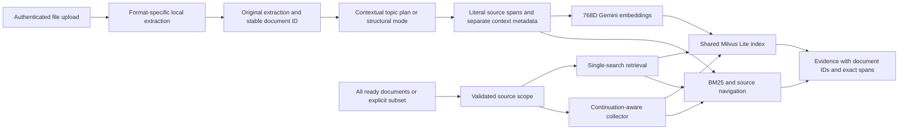

# Stack, provenance, and implementation rationale

The original source is the `education` project's RAG-Anything trial at commit
`3d99139` (`feat(retrieval): gather source evidence with traversal tools [T-025]`).
[source-provenance.json](source-provenance.json) records original file hashes.
Those hashes identify the starting material, not a claim that the current service
files remain byte-identical. The source project remains untouched.

The same provenance record identifies the contextual-chunking design reference in
the education service, last changed at `2b019db`. Topic planning and exact-source
slicing informed this implementation; its parser-block integration, page spans,
bounded embedding payloads and shared-library scope are implemented here.

The first handoff added HTTP/MCP service boundaries around its evidence-only agent.
This revision changes ingestion and indexing: a persistent multi-document library,
multiple file formats, contextual chunks, and a directly owned shared vector index.
It keeps independently callable single-search and agentic retrieval.

## Components and their actual responsibilities

| Component | Version / configuration | Used for |
| --- | --- | --- |
| Python | 3.12, Linux x86-64 | Service runtime and isolated parser subprocesses |
| RAG-Anything | 1.4.2 | Text/Markdown parsing, MinerU adapter, legacy Office conversion helpers |
| MinerU | 3.4.1 | PDF/image CPU extraction and native DOCX/PPTX/XLSX extraction |
| PDFium binding | pypdfium2 4.30.0 | Required compatibility pin for this MinerU version |
| LibreOffice | Host/container distribution packages | Convert legacy DOC/PPT/XLS before PDF extraction |
| Milvus Lite / pymilvus | See runtime lock | Direct persistent shared collection with document-ID filters |
| Gemini embeddings | gemini-embedding-001, normalized 768D | Contextual chunk and query vectors |
| Gemini chunk planner | gemini-2.5-flash | Topic partition and labeled context metadata during contextual ingestion |
| Gemini retrieval planner | gemini-2.5-pro default; Flash selectable | Agent tool decisions and passage review |
| FastAPI / Uvicorn / Pydantic | See runtime lock | HTTP contracts, validation, OpenAPI and NDJSON |
| MCP | 1.30.0 plus supplemental lock | Eight-tool stdio bridge to the HTTP service |
| SQLite | Python standard library | Transactional conservative usage reservations |
| BM25 / RRF | Our implementation; RRF k=60 | Lexical ranking and keyword/vector rank fusion |

[requirements.lock](../requirements.lock) is the hash-pinned core dependency set.
[requirements-mcp.lock](../requirements-mcp.lock) includes that lock and bridge
additions. [dependency-inventory.json](dependency-inventory.json) records the source
candidate environment, not a fresh image install. LightRAG 1.4.16 remains an upstream
dependency of standalone RAG-Anything, but this runtime does not initialize its graph
indexing/query pipeline. Do not independently upgrade it to 1.5: the installed
RAG-Anything version requires LightRAG below 1.5.

The [model manifest](../models.json) pins 40 MinerU files to PDF-Extract-Kit revision
`ed6b654c018d742e65a17671e379c5e6ecc87ec9`. Preparation checks sizes and recorded
SHA256 hashes. Small files without recorded hashes are pinned by revision and size.
Weights are downloaded during setup, not shipped in the ZIP. Text/Markdown, built-in
HTML and native modern Office parsing do not use these OCR weights.

## Data flow

Our `engine.py` opens Milvus Lite directly under the data directory. It does not
borrow `rag.lightrag.chunks_vdb._client`, call `insert_content_list`, or construct
unused entities/relationships and visual descriptions. The active source index
comes from extracted source text and our contextual chunker. No upstream generated
answer route is exposed; `naive` means one search of our index.

## Contextual chunking and citation integrity

`retrieval_lib/chunking.py` creates ordered units from extracted page text and
structure. Paragraphs, sentences, table rows, code, headings, and word boundaries
inform segmentation; oversized units receive explicit safety splits. Every character
of every nonblank extracted page is covered, including inter-block whitespace.

Contextual mode asks Flash for a complete topic partition of bounded windows.
The planner can label and group source units but cannot provide replacement source
text. Its partition and metadata are checked locally. Structural mode is an explicit
operator choice, not a silent fallback after a model failure.

| Bound | Current value |
| --- | --- |
| Source text per indexed chunk | At most 1,400 UTF-8 bytes |
| Full embedding text, including context | At most 2,000 UTF-8 bytes |
| Source units per planning window | At most 48 |
| Source text per planning window | At most 12,000 UTF-8 bytes, plus bounded context |
| Contextual planning windows per document | At most 128 |

These caps bound requests rather than target an arbitrary chunk length. Topic groups
can cross page/citation and embedding safety splits within a window. They do not
cross planning-window boundaries. The embedding includes the complete source chunk;
only contextual prefixes are clipped to their own allowances. Long-block tails
become subsequent chunks instead of disappearing from semantic indexing.

Chunk metadata includes topic/neighbor IDs, exact page offsets, a section label,
`context_note`, structural context and `split_reason`. Generated labels/notes remain
separate from literal evidence. Stable fingerprints cover source identity/content,
mode/model, title, units, algorithm version and limits. Per-window plans are cached
atomically and validated before reuse. No partially planned document becomes ready.
The public API currently retries by a new upload; it does not expose checkpoint
resumption for an existing failed document.

`source.py` supplies exact extraction spans, inferred heading trees, search results
and navigation. It adapts physical PDF pages and non-PDF logical locations without
claiming printed pagination for Office/text files. Scoped access combines selected
ready documents while preserving each passage's actual source identity.

`vectors.py` stores contextual chunks in a shared collection with `source_id`.
Vector queries filter that field before selecting top-k. BM25 and agent tool access
use the same resolved scope. Source and chunk identities prevent collisions across
documents containing identical page numbers, headings or local block IDs.

## Inherited agent behavior

The substantive continuation-aware controller remains in `collector.py`:

- Emit initial keyword evidence before paid query planning.
- Make heading contents, page/chapter windows and next/back traversal available.
- Show truncation and neighbors; ask the planner to inspect continuations and
  missing aspects rather than repeatedly search or read the same window.
- Combine accept/reject decisions with useful tool actions.
- Validate known passage IDs, action types, conflicting reviews and source scope.
- Retain candidates when provider, budget, timeout or interruption stops selection.
- Bound decisions, evidence, source windows, time and provider input/output.

The historical 62.5% vector and 87.5% revised Flash required-block recall figures
came from four tasks on one paper using the previous source-block representation.
They are not results for this contextual, multi-document revision. See
[historical results](historical-results.md). The separate
[live diagnostic](live-results.md) measures this revision on two PDFs and records
its failures and mixed-version retests; it does not compare upstream RAG-Anything.

The live diagnostic exposed a model transcription failure on long citation IDs.
The planner now receives stable per-run aliases (`E1`, `E2`, ...), which map only
to already admitted evidence. Complete known IDs remain accepted for compatibility;
unknown aliases and shortened hashes fail. Public citations retain their original
full IDs, exact spans and hashes. This reduces copying burden without weakening
evidence identity or permitting model-authored source text.

## Service and format boundaries

`documents.py` validates suffix/MIME agreement, file structure and parser prerequisites.
`parse_document.py` runs local extraction, normalizes the result, and disables remote
Markdown image resolution. HTML uses our text/structure parser without a renderer.
Modern Office uses MinerU's native parsers; legacy formats use LibreOffice conversion.
The exact format table is in the [capability brief](capability-brief.md).

`api.py` separates normal and agentic routes and exposes catalog, receipts, original
downloads, source tools and spend status. `source_ids` omission/null means all ready;
an explicit empty list means none. A global integration key authenticates access.
Neither that key nor a caller-supplied selection implements per-user authorization.

`engine.py` serializes ingestion and retrieval and persists document receipts.
Restart reopens ready documents; interrupted processing is failed explicitly.
Vector search calls `load_collection` before count/integrity queries because a
fresh Milvus process may reopen a collection as released. The storage smoke
explicitly exercises that state. Worker initialization failures produce HTTP 503
and release admission; optional trace-write failures do not discard completed HTTP
results. Oversized embedding input fails before any provider reservation, preserving
the no-silent-truncation invariant for multibyte query text as well as source chunks.
`config.py` supplies portable paths, chunk mode, credentials and limits. Parser
subprocess cancellation terminates the process group. An exclusive directory lock
prevents multiple workers from opening the same Milvus file.

`spend.py` retains the original conservative reservation mechanism with a per-service
operator ceiling. Failed/unknown-usage calls keep their reservation. Private query
traces are opt-in. `mcp_server.py` adapts the original eight-tool bridge to the new
catalog/selection API using authenticated HTTP, without opening a second index.

Existing version-one data is not automatically converted. Its receipts/index layout
and source-block embeddings differ from the new shared contextual index; re-upload
originals. Native/Docker recipes, tests and guides are included, with actual checks
and outstanding runtime limits recorded in [validation](validation.md).

## Separate upstream diagnostic

`scripts/evaluate_upstream.py` is an opted-in evaluation harness, not the service's
runtime path. It calls unmodified RAG-Anything content-list ingestion and native
LightRAG retrieval, with separate storage and the existing spend ledger. Provider
events are checked independently of upstream's processed flag because budget-limited
ingestion exposed a false-success condition. Explicit resume preserves history and
uses the upstream force-multimodal-reprocess API; it does not patch upstream code.
The final recovery adds exact-input provider caching to the diagnostic adapter:
document embeddings reuse verified native float32 vectors (not the lower-precision
metadata copy), while query embeddings and keyword generation remain uncached.
Successful new document vectors and generation responses are retained privately.
Prior reservations are never refunded. Model, task type and dimensions are part
of cache identity; native float32 rounding remains part of the resumed index.

`scripts/upstream_integrity.py` implements a narrow recovery guard for this corpus.
It rejects broader damage, removes at most ten uncommitted modal entity vectors
through native APIs after their embeddings are cached, and preserves an index
snapshot and audit. Before queries it checks native text chunks, the eight original
table/image items, document chunk lists, vector stores, and every graph/vector
source reference. This is a repaired resumed run; it cannot supply a clean
single-pass ingestion cost.

`scripts/score_upstream.py` replays pinned native text windows and maps unchanged
characters to exact source offsets. Generated multimodal/graph descriptions do not
receive literal-evidence credit; failed provider events mark packets degraded.
The completed comparison covered 18/18 required spans in all three modes; our
hybrid returned about 8.4x less chunk context than upstream. See the
[actual comparison](upstream-comparison.md), including prior budget stops, native
caption fallback, repair history and the limits of this small diagnostic.
